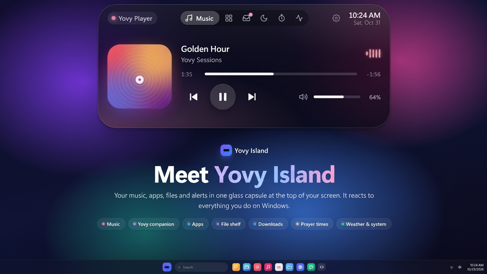
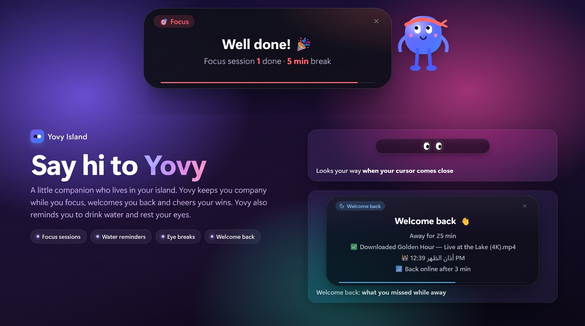
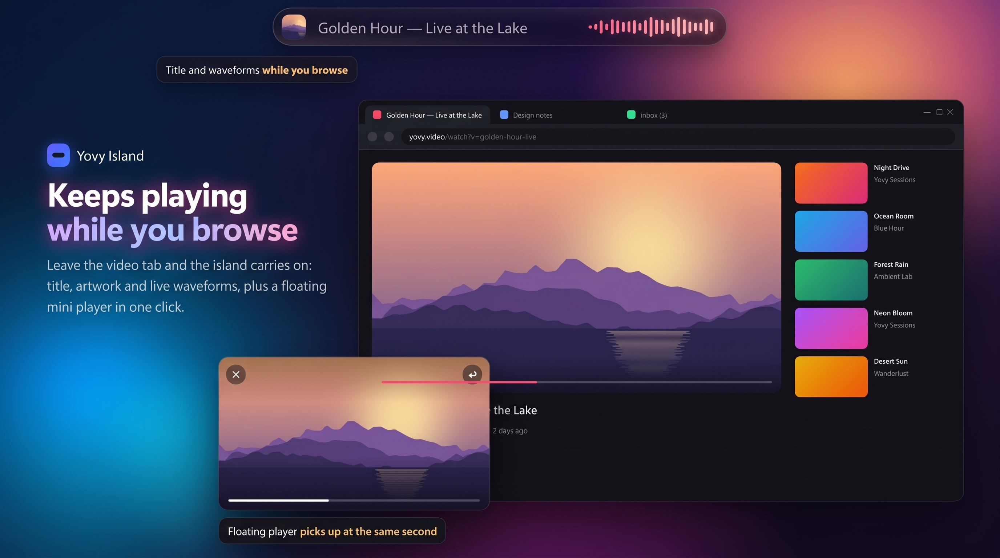
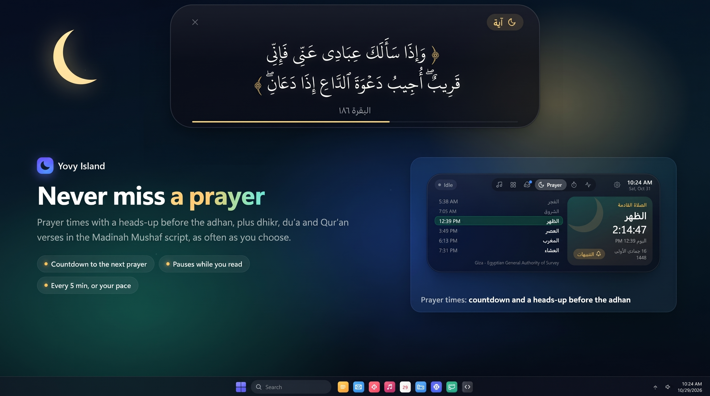
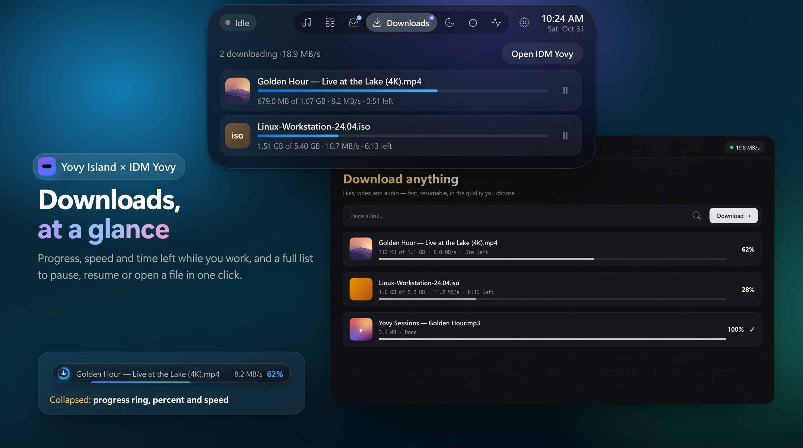
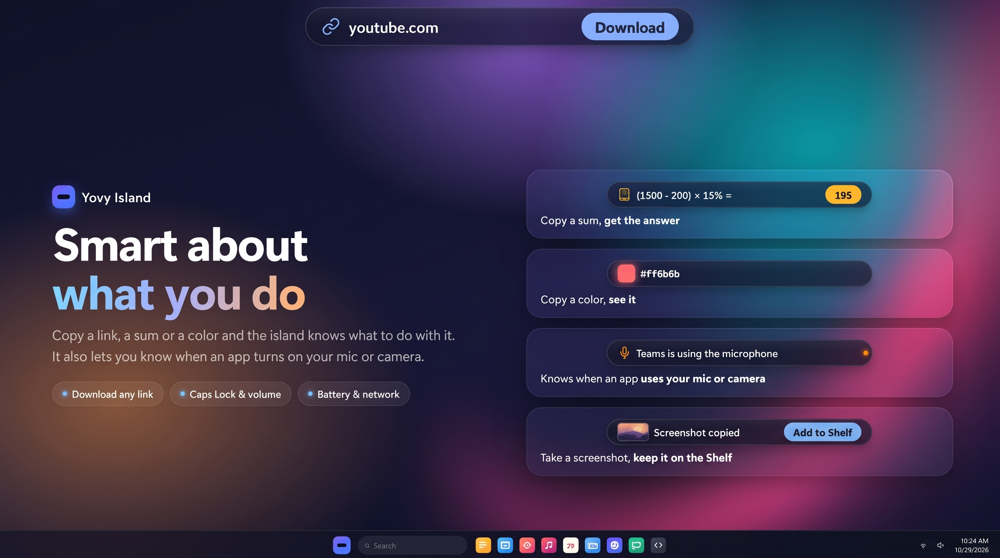
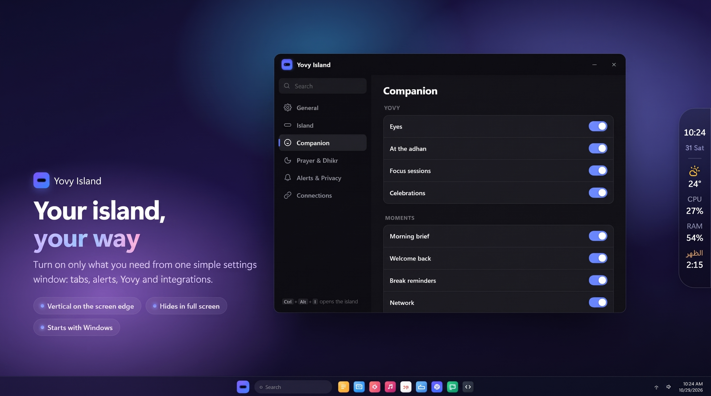

<div align="center">

# YOVY-NAV

**A living navigation island for your Windows desktop.**

Your music, apps, files and alerts in one glass capsule at the top of your screen — with Yovy, a little companion who keeps you company.

[**Download for Windows (v1.5.0)**](https://github.com/youssef-113/Yovy-nav/releases/latest) · [**All Releases & Tags**](https://github.com/youssef-113/Yovy-nav/tags) · Free and open source (GPL v3)

[](https://github.com/youssef-113/Yovy-nav/releases/latest)
[](https://github.com/youssef-113/Yovy-nav/stargazers)
[](https://ko-fi.com/binamer)



</div>

## What's New in v1.5.0 🚀

- **13 Complete Themes Integrated**: Full visual integration of the 13 original themes (*Original YOVY*, *Bakka*, *Outline*, *Midnight*, *Forest*, *Snow*, *Cat*, *Galaxy*, *Aurora*, *Ocean*, *Nody*, *Lava*, *Retro*).
- **Centralized Live Theme Engine**: Instantaneous live theme switching across the island capsule, expanded panels, task manager, prayer schedules, sticky notes, media player, and secondary windows with zero page reload.
- **Theme Gallery in Settings**: Brand-new interactive themes page in Settings with real-time visual previews, live color chips, and 1-click persistent selection.
- **Intelligent CPU & Battery Optimization**: Automatically suspends desktop backdrop capture when solid themes are active, dramatically reducing idle CPU and GPU usage.
- **Adaptive Companion & Visual Motifs**: Features custom cat ears & paw eye tracking for Cat theme, sakura petals for Nody theme, monospace font & square radius for Retro theme, and celestial/nature gradients for Galaxy, Aurora, Ocean, and Lava.

## What's New in v1.4.2 🚀

- **Zero-Loss Atomic Storage Engine**: Upgraded `settings.js` with atomic file transactions (`.tmp` write + `fs.renameSync`), automatic `.bak` backup generation, and seamless self-healing fallback if any store is corrupted.
- **Inline Task Editing & Progress Stats**: Double-click any active task to edit its title directly (`Enter` to commit, `Escape` to cancel) + real-time completion progress tracking (`X remaining · Y of Z completed (N%)`).
- **Smart Clipboard Email Classification**: Added email recognition (`mailto:` action) alongside links, calculations, colors, and word counters.
- **Reminder Card Hard Ceiling & Escape Dismiss**: Added a ceiling preventing hover from stalling Dhikr/Du'a cards indefinitely, with instant keyboard `Escape` key dismissal.
- **Instant Scratchpad Notes Persistence**: Added local caching alongside bridge syncing so sticky notes load with zero delay and are protected against unexpected system reboots.
- **Hardened IPC & Input Validation**: Added strict type and bounds assertions across `apps`, `shelf`, and `clip-action` handlers to prevent IPC communication exceptions.

## Features

### Say hi to Yovy

A little companion who lives in your island. Yovy keeps you company while you focus, welcomes you back, cheers your wins, and reminds you to drink water and rest your eyes.



### Keeps playing while you browse

Title, artwork and live waveforms of whatever is playing, plus a floating mini player in one click.



### Never miss a prayer

Prayer times with a heads-up before the adhan, plus dhikr, du'a and Qur'an verses in the KFGQPC Hafs script, as often as you choose.



### Task Reminders & To-Do List

Schedule tasks with custom dates and times right from the island shortcuts. Features:
- **12-hour editable time format** (`[ 09 : 30 ] [ AM ▼ ]`) with auto-conversion and validation
- **Day & date picker selection** (`Today`, `Tomorrow`, or custom date picker)
- **Fluid vertical scrolling** for task lists and activities
- **Quick presets** (`+10m`, `+30m`, `+1h`, `+3h`, `Today`, `Tomorrow`)
- **Configurable reminder intervals** - set how often to be reminded (1 min to 1 hour) globally or per-task
- **Flexible per-task settings** - override global reminder frequency for specific tasks
- **Live countdowns** on the idle pill showing time remaining
- **Persistent audio/toast alerts** when overdue until finished
- **Enhanced celebration** with multi-wave sparkles and uplifting sounds when completing tasks
- **Finished tasks table** with celebratory "Well done! 🎉" messages
- **Edit tasks** directly from the Settings window

### Downloads, at a glance

Progress, speed and time left while you work, with IDM Yovy — pause, resume or open a file in one click.



### Shelf & Quick Sticky Notes

Drag files or screenshots onto the island to keep them handy and drag them out anywhere. Beside your staged files, an instant scratchpad keeps phone numbers, code snippets, and to-do lists auto-saved to `%AppData%\yovy-nav\notes.json` with 0.0% idle CPU load.

### Smart about what you do

Copy a link, a sum or a color and the island knows what to do with it. It also lets you know when an app turns on your mic or camera.



### Your island, your way

Turn on only what you need from one simple settings window. Vertical on the screen edge, hides in full screen, starts with Windows.



## Install on Windows

1. Download **YOVY-NAV Setup** (`YOVY-NAV-Setup-1.5.0.exe`) from [Releases](https://github.com/youssef-113/Yovy-nav/releases/latest) or browse all releases in [Tags](https://github.com/youssef-113/Yovy-nav/tags).
2. Run it. Windows may show *"Windows protected your PC"* because the app is not code-signed yet — choose **More info → Run anyway**.
3. The island appears at the top of your screen. Press **Ctrl + Alt + I** to open it.

### Download Links
- **Latest Release (v1.5.0)**: [Download YOVY-NAV-Setup-1.5.0.exe](https://github.com/youssef-113/Yovy-nav/releases/download/v1.5.0/YOVY-NAV-Setup-1.5.0.exe)
- **All Releases**: [GitHub Releases Page](https://github.com/youssef-113/Yovy-nav/releases)
- **Tags & Source Code Archive**: [GitHub Tags Archive](https://github.com/youssef-113/Yovy-nav/tags)

> Requires Windows 10 or 11 (64-bit).

## Build from source

```bash
npm install
npm start          # run it locally
npm run dist       # build the Windows installer into dist/
```

## License

YOVY-NAV is free software, licensed under the [GNU General Public License v3.0](LICENSE).

Copyright © 2026 YOVY-NAV by Joe.

The Qur'an font in `fonts/` (KFGQPC HAFS Uthmanic Script by the King Fahd Glorious Quran Printing Complex) is included unmodified under its own license — see [fonts/KFGQPC-LICENSE.txt](fonts/KFGQPC-LICENSE.txt). It is not covered by the GPL.

The name "YOVY-NAV" and its logo are not covered by the GPL; please use a different name for modified versions.
