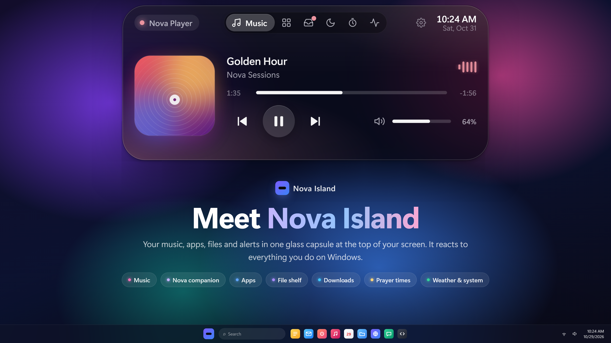
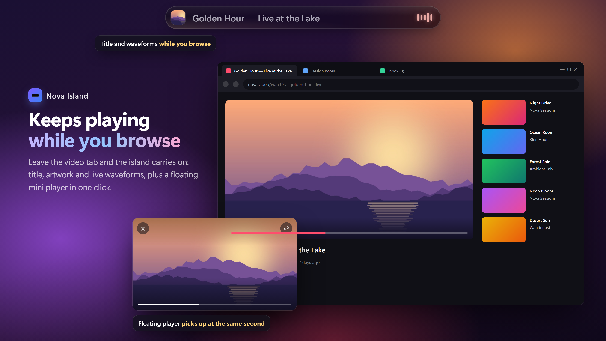
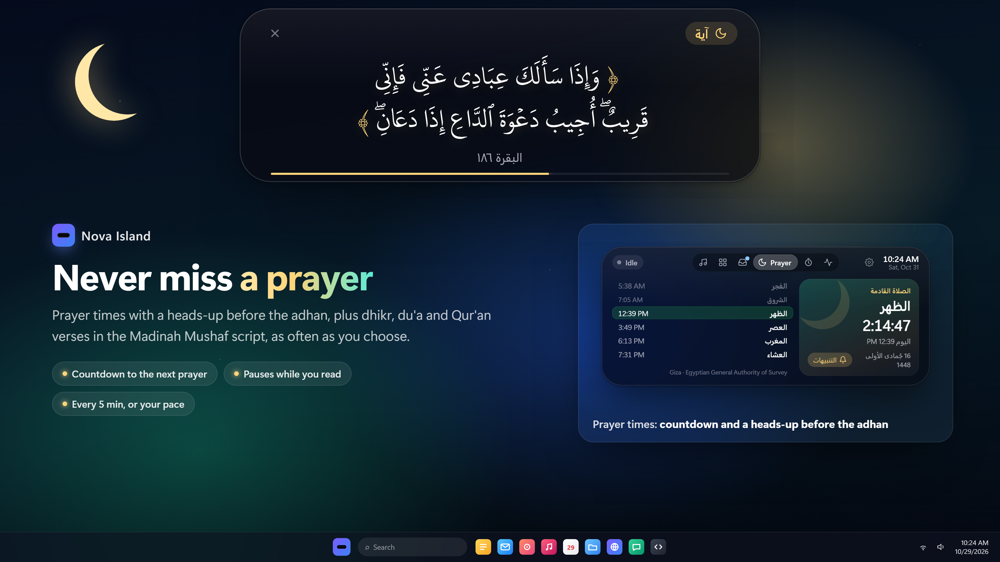

<div align="center">

# YOVY-NAV

**A living navigation island for your Windows desktop.**

Your music, apps, files and alerts in one glass capsule at the top of your screen — with Yovy, a little companion who keeps you company.

[**Download for Windows**](../../releases/latest) · Free and open source (GPL v3)

[](../../releases/latest)
[](../../stargazers)
[](https://ko-fi.com/binamer)



</div>

## Features

### Say hi to Yovy

A little companion who lives in your island. Yovy keeps you company while you focus, welcomes you back, cheers your wins, and reminds you to drink water and rest your eyes.


### Keeps playing while you browse

Title, artwork and live waveforms of whatever is playing, plus a floating mini player in one click.



### Never miss a prayer

Prayer times with a heads-up before the adhan, plus dhikr, du'a and Qur'an verses in the KFGQPC Hafs script, as often as you choose.



### Downloads, at a glance

Progress, speed and time left while you work, with IDM Yovy — pause, resume or open a file in one click.


### Smart about what you do

Copy a link, a sum or a color and the island knows what to do with it. It also lets you know when an app turns on your mic or camera.


### Your island, your way

Turn on only what you need from one simple settings window. Vertical on the screen edge, hides in full screen, starts with Windows.


## Install on Windows

1. Download **YOVY-NAV Setup** (`YOVY-NAV-Setup-1.3.1.exe`) from the [latest release](../../releases/latest).
2. Run it. Windows may show *"Windows protected your PC"* because the app is not code-signed yet — choose **More info → Run anyway**.
3. The island appears at the top of your screen. Press **Ctrl + Alt + I** to open it.

> Requires Windows 10 or 11 (64-bit).

## Build from source

```bash
npm install
npm start          # run it locally
npm run dist       # build the Windows installer into dist/
```

## Support YOVY-NAV ☕

YOVY-NAV is free, with no ads and no tracking, and it always will be. If it makes your day a little better, you can buy us a coffee:

- **Ko-fi** (cards, PayPal): [ko-fi.com/binamer](https://ko-fi.com/binamer)
- **InstaPay** (Egypt): [Send via InstaPay](https://ipn.eg/S/binamerbm/instapay/38txJO)

Stars ⭐ and sharing it with a friend help a lot too.

## License

YOVY-NAV is free software, licensed under the [GNU General Public License v3.0](LICENSE).

Copyright © 2026 YOVY-NAV by Joe.

The Qur'an font in `fonts/` (KFGQPC HAFS Uthmanic Script by the King Fahd Glorious Quran Printing Complex) is included unmodified under its own license — see [fonts/KFGQPC-LICENSE.txt](fonts/KFGQPC-LICENSE.txt). It is not covered by the GPL.

The name "YOVY-NAV" and its logo are not covered by the GPL; please use a different name for modified versions.
